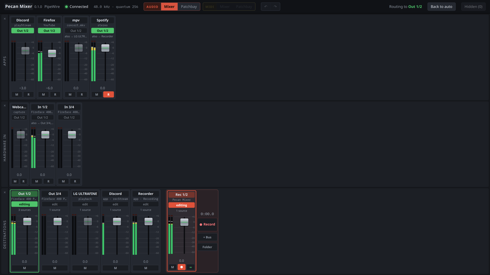
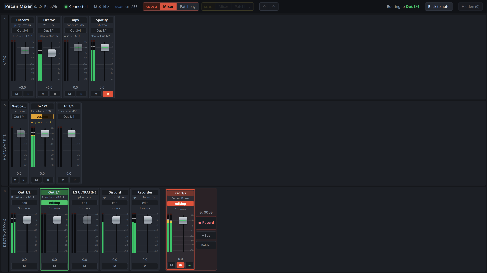
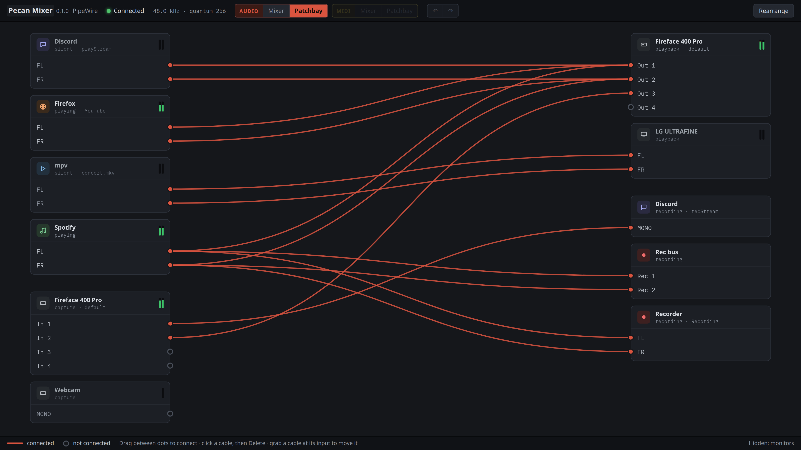
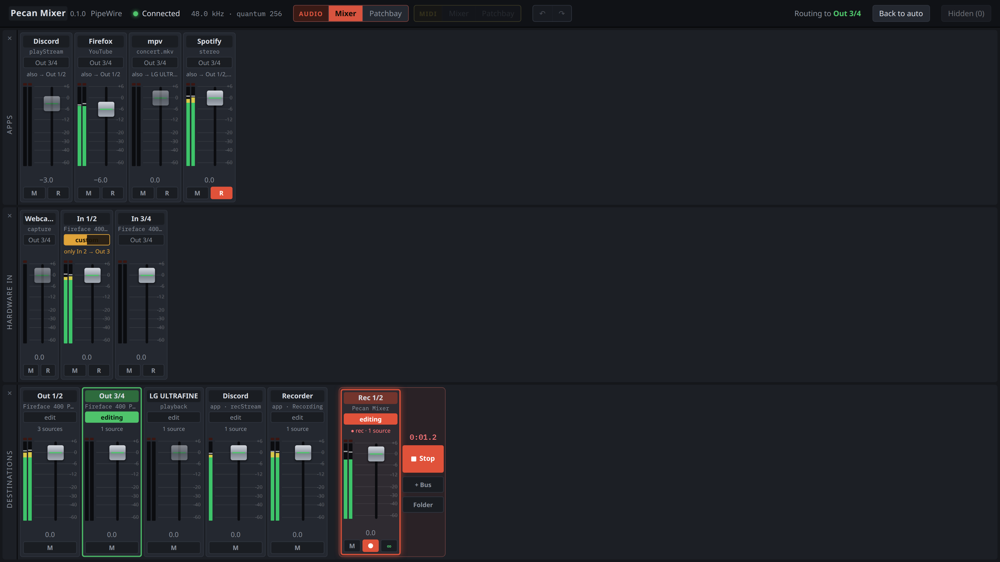
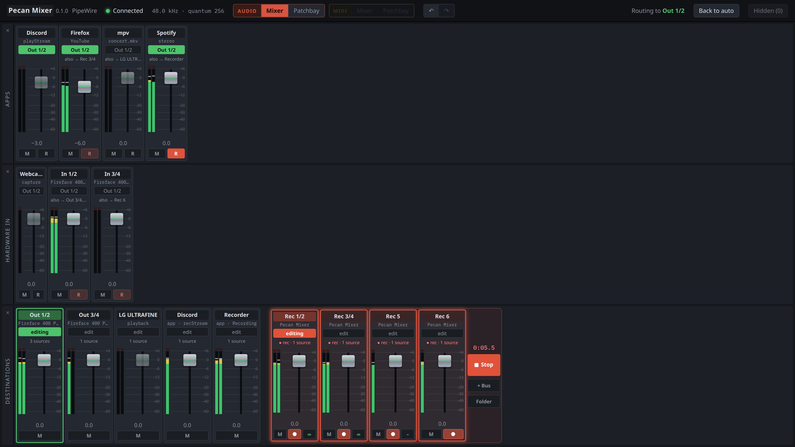

# Pecan Mixer

A patchbay and mixer for PipeWire on Linux. A tidier successor to qpwgraph,
and a sibling of [CachyMix](https://github.com/BadgerSoft-NL/cachymix-rme-ff-400).

Pecan Mixer is a plain PipeWire client: it reads nodes, ports and links, and
makes and removes links. WirePlumber stays in charge of policy; you
reach for Pecan Mixer when you want to deviate from what it auto-connects —
for example to record Spotify, a browser tab and a microphone at once.



## Status

Early, but in daily use. What works now:

- **Audio mixer** in TotalMix "edit mix" style: pick a destination with
  *edit*, then switch each app or input on or off for it. Moving a stream uses
  `target.object`, like pavucontrol; extra routes become links. Patches the
  mixer can't show as on/off are marked *custom* and left alone. **Back to
  auto** removes every manual route and hands control back to WirePlumber.
  Faders set the stream's own volume; level meters show what each source and
  destination carries. Rows can be hidden and resized; right-click a row to
  make them all equal again. In Destinations, drag the grip between the
  outputs and the Rec buses to share the width; each side scrolls on its own.

  
- **Audio patchbay**, ordered: sources on the left, destinations on the
  right, with mini level meters. Drag between dots to connect, click a cable
  to disconnect. Modules can be dragged; **Rearrange** puts them back.

  
- **Recorder**: *Rec buses* sit in their own box among the destinations,
  stereo or split into two mono buses. Add one with **+ Bus**, remove one with
  its **×** (the buses after it move up, routes and all). Pick a bus, then
  press **R** on a source to send it there. Arm buses with their **●** like
  in Ableton: click arms only that bus, Ctrl+click adds or removes it.
  **Record** records every armed bus at once, sample-aligned; arming or
  disarming a bus while recording drops it in or out. Every bus becomes one
  WAV (32-bit float), and every take goes to its own
  `~/Recordings/YYYY-MM-DD_HHMM/`. **Folder** opens it.

  

  
- **Lives in the system tray** ("Status and Notifications" in KDE), like
  CachyMix. Click the icon to show or hide the window; right-click for the
  menu. Closing the window keeps it running, and recordings keep going.
  Optionally starts at login, hidden.
- Live view of the PipeWire graph, reconnecting when the server restarts.

**MIDI is switched off for now.** The MIDI mixer, MIDI patchbay, MIDI
recording and the external MIDI clock are written but not yet tested with
real devices, so their buttons are greyed out.

## Requirements

- Linux with PipeWire and WirePlumber 0.5.
- For the tray icon: a desktop with StatusNotifierItem support, such as KDE
  Plasma, or GNOME with the AppIndicator extension.

## Install

Download the AppImage from the
[releases page](https://github.com/BadgerSoft-NL/pecanmixer/releases),
make it executable and run it:

```bash
chmod +x Pecan.Mixer_*_amd64.AppImage
./Pecan.Mixer_*_amd64.AppImage
```

Right-click the tray icon and tick **Start at login** if you want it to
always be there.

## Build from source

Needs Rust, Node.js, and the PipeWire development headers plus clang
(for `pipewire-rs`).

```bash
npm install
npm run tauri dev
```

## License

GPL-3.0-or-later. See [LICENSE](LICENSE).
